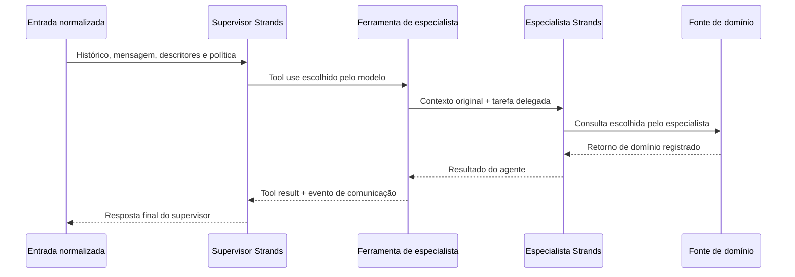

# Estrutura executada e dicionário

`static-definition.json` contém os prompts de sistema integrais, hashes por papel e competência, esquemas das ferramentas e placeholders dinâmicos. Esses placeholders são preenchidos exclusivamente com o prefixo disponível da conversa, mensagem atual, descritores estáveis e indicação da política comum. Referências de avaliação, respostas esperadas e mensagens futuras não entram no contexto dos agentes.

| Configuração | Decisão inicial | Especialistas | Comunicação | Autoridade final |
|---|---|---|---|---|
| Centralizada v4.2 | supervisor escolhe ferramentas por inferência | FAQ, estoque, anexos; fábrica comum | supervisor → ferramenta de especialista → agente → fonte → retorno | próprio supervisor |
| Workflow | router retorna plano de rotas | mesmas definições de domínio | estágios sequenciais e evidências ao sintetizador | sintetizador |
| Swarm | coordenador retorna plano inicial | mesmas definições + ferramenta peer | plano inicial e delegações entre pares, sem ciclos ativos | síntese explícita final |

O supervisor central não recebe ferramentas de domínio e não retorna JSON para executar um pipeline fixo. Cada ferramenta `faq_specialist`, `stock_specialist` ou `attachments_specialist` chama uma instância real de `strands.Agent`, usando o modelo registrado. Os especialistas centrais não recebem ferramenta de peer. O supervisor recebe resultados antes de concluir. O cumprimento mínimo é verificado depois da execução, sem fabricar delegação ausente.

O diagrama representa uma consulta possível, não uma chamada obrigatória a todas as fontes. A interface constrói nós a partir de eventos `agent.started`, associa retornos aos eventos reais e não acrescenta um streamer ou especialista fictício. Os testes controlados provam consultas às fontes; um especialista real ainda pode deixar de consultar uma fonte em inferência livre, e isso permanece um resultado observável de procedimento.

## Eventos e contadores

| Campo | Definição |
|---|---|
| `runId` / `attempt_id` / `unit_id` | execução da aplicação, primeira tentativa e unidade planejada |
| `agentId` | instância de agente, isolada por tentativa |
| `agentInvocationId` / `callId` | invocação do agente ou requisição física, conforme a família do evento |
| `parentAgentInvocationId` | invocação de agente que originou o filho |
| `parentCallId` / `toolCallId` | vínculo com invocação/ferramenta que originou a chamada |
| `actual_agents` | agentes distintos que efetivamente iniciaram requisições ao modelo |
| `agent_invocations` | invocações de agentes iniciadas; reconsultas contam novamente |
| `model_requests` | requisições físicas únicas iniciadas ao provedor |
| `domain_tool_calls` | chamadas a FAQ, estoque ou ingestão de anexos; não inclui consultar especialista |
| `coordination_tool_calls` | chamadas de ferramentas de especialista e coordenação entre pares |
| `specialist_tool_invocations` | invocações de agentes como ferramentas do supervisor |
| `handoffs_requested` | delegações explícitas do swarm, incluindo plano inicial identificado |
| `inter_agent_explicit_messages` | saídas entre agentes e solicitações explícitas de delegação, conforme eventos |
| `architectural_compliance` | contrato técnico verificado no registro, independente do juiz |
| `task_success` | conclusão técnica, contrato, conteúdo e evidência obrigatória; desconhecidos explícitos |
| `content_success` | conteúdo avaliado independentemente da consulta obrigatória e do contrato arquitetural |
| `procedure_compliance` | consulta obrigatória com ferramenta, argumento, retorno íntegro e especialista real |
| `token_measurement_complete` | cobertura integral dos tokens de requisições físicas únicas |
| `known_partial_*` | consumo observado quando o total não é conhecido; não substitui o total |
| `latency_ms` | execução do núcleo e instrumentação local |
| `end_to_end_latency_ms` | fronteira histórica do coletor: processo/importação/núcleo/arquivos |
| `estimated_generation_cost_usd` | estimativa de tarifa × tokens medidos; não é cobrança efetiva |

Eventos preservam início, término, status, papel, entrada e retorno no pacote restrito. Métricas acumuladas do SDK são diagnósticas: o total da execução usa o ledger de requisições físicas únicas. Desconhecido permanece desconhecido. Erros, interrupções e chamadas abertas são preservados. A API usa processo por tentativa e watchdog para encerrar descendentes no limite global; o benchmark mantém seu subprocesso histórico.

A retenção de contexto ocorre apenas entre invocações do mesmo especialista dentro da tentativa. Cada tentativa cria sua própria fábrica, seus agentes, históricos e contadores. Não há memória entre cenários, repetições ou arquiteturas.

## Reprodução

O coletor exige a configuração calibrada e congela commit, dependências, código, assets, casos, contexto, política, esquemas, análise, ordem e seleção de rechecagens antes das respostas. Retomada só executa unidades ainda não iniciadas. Um defeito que invalide o lote exige novo lote integral; primeiras tentativas e julgamentos não são substituídos por alternativas favoráveis.

O pacote privado conserva os comandos efetivos. A validação API/interface e o piloto de 18 execuções são fases próprias. As 600 unidades usam os 40 casos originais verificados por hash, com todas as três condições executadas novamente.
