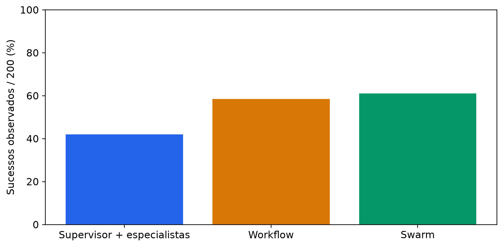
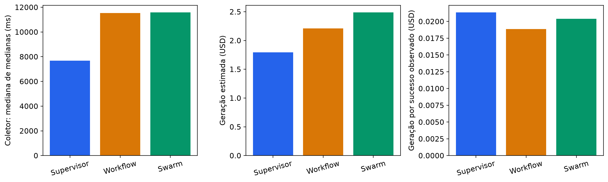
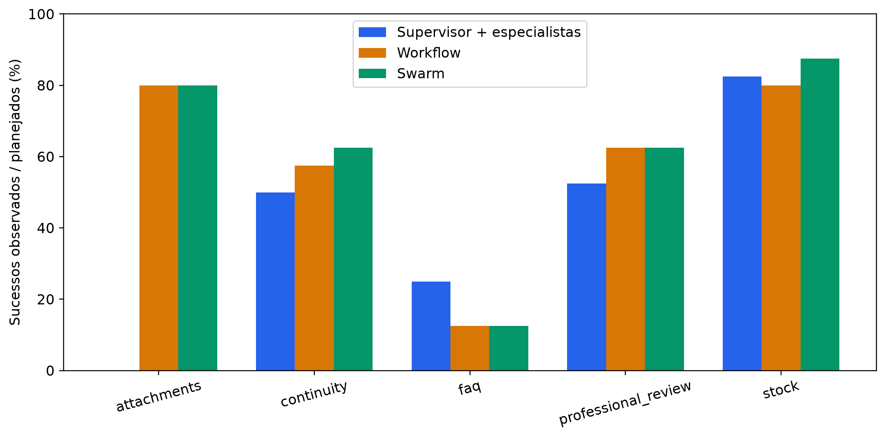
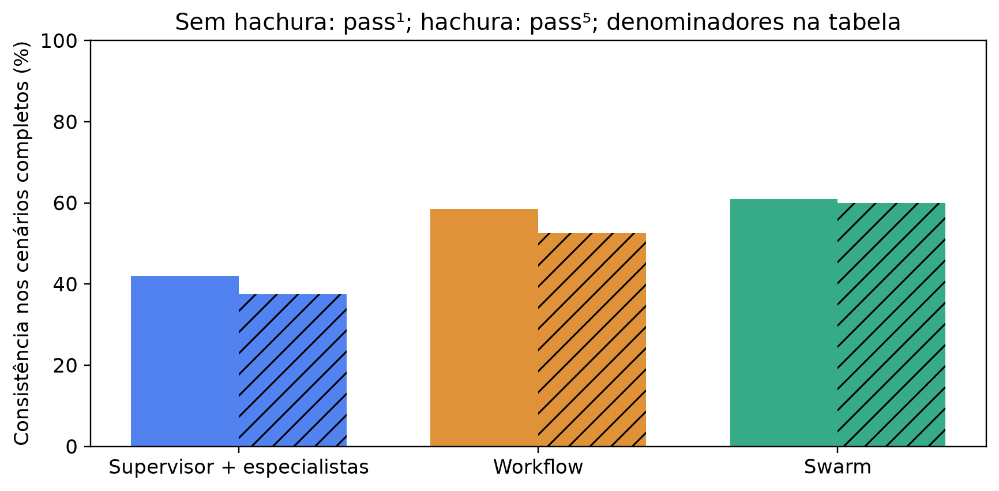
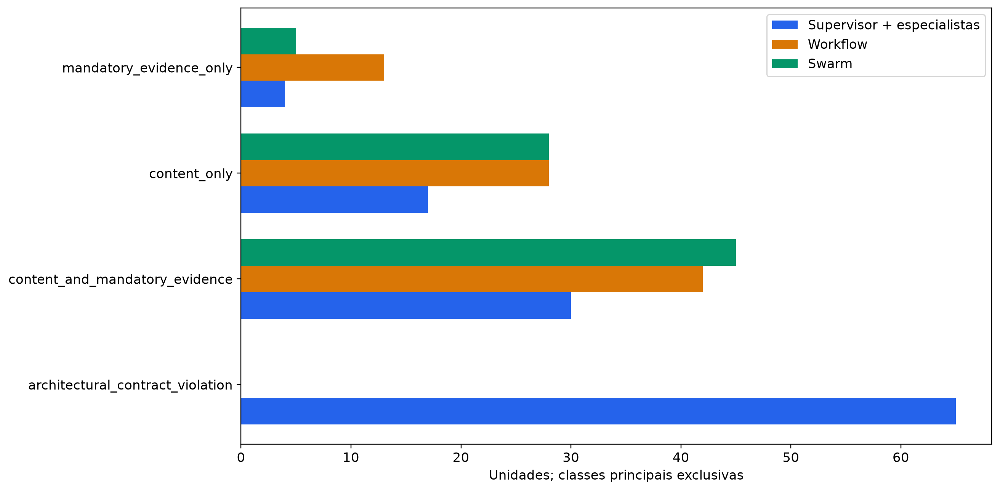

# Nova comparação arquitetural — v4.2

Foram preservadas 600 unidades novas e únicas: 40 cenários × cinco repetições × três arquiteturas. A condição centralizada usa supervisor com agentes especialistas como ferramentas. O cenário é a unidade pareada; as cinco repetições permanecem agrupadas.

| architecture | planned | technical_successes | architectural_compliant | architectural_violations | task_successes | task_failures | task_unknown | judge_schema_valid | judge_valid_assessment |
| --- | --- | --- | --- | --- | --- | --- | --- | --- | --- |
| centralized_orchestration | 200 | 200 | 135 | 65 | 84 | 116 | 0 | 200 | 200 |
| structured_workflow | 200 | 200 | 200 | 0 | 117 | 83 | 0 | 200 | 200 |
| decentralized_swarm | 200 | 200 | 200 | 0 | 122 | 78 | 0 | 200 | 200 |

O sucesso exige conclusão técnica, conformidade arquitetural, conteúdo sob o instrumento congelado e consulta obrigatória comprovada. Julgamentos inválidos e desconhecidos são explícitos. Falhas legítimas foram preservadas; a seleção não depende de favorecer uma arquitetura.

| architecture_a | architecture_b | paired_scenarios | difference_pp_b_minus_a | bootstrap_95_low_pp | bootstrap_95_high_pp | p_holm_three_comparisons |
| --- | --- | --- | --- | --- | --- | --- |
| centralized_orchestration | structured_workflow | 40 | 16.5000 | -1.0000 | 34.0000 | 0.1700 |
| centralized_orchestration | decentralized_swarm | 40 | 19.0000 | 0.5000 | 37.0000 | 0.1700 |
| structured_workflow | decentralized_swarm | 40 | 2.5000 | -3.0000 | 9.0000 | 0.6250 |

Intervalos percentis usam 20.000 reamostragens de cenários. Testes bilaterais de permutação pareada usam enumeração exata até 16 diferenças não nulas ou 99.999 permutações, com ajuste plus-one; Holm corrige as três comparações. Semente 20261011. Intervalos são condicionais à amostra intencional conhecida; não demonstram generalização clínica.

| architecture | content_successes | content_evaluable | mandatory_evidence_applicable | mandatory_evidence_compliant | mandatory_evidence_evaluable | complete_scenarios | pass_1_complete | pass_5_complete |
| --- | --- | --- | --- | --- | --- | --- | --- | --- |
| centralized_orchestration | 140 | 200 | 95 | 56 | 95 | 40 | 0.4200 | 0.3750 |
| structured_workflow | 130 | 200 | 95 | 40 | 95 | 40 | 0.5850 | 0.5250 |
| decentralized_swarm | 127 | 200 | 95 | 45 | 95 | 40 | 0.6100 | 0.6000 |

Latência do núcleo (`latency_ms`), latência do coletor (`end_to_end_latency_ms`, processo/importações/arquivos), API e julgamento têm fronteiras distintas. O benchmark mede o transporte histórico direto do núcleo, sem HTTP, banco ou interface. Os contadores somam requisições físicas únicas; métricas acumuladas dos agentes não são somadas novamente.

| architecture | end_to_end_latency_ms_median_of_case_medians | total_tokens_total | model_requests_total | domain_tool_calls_total | specialist_tool_invocations_total | estimated_generation_cost_usd | estimated_cost_per_observed_task_success_usd |
| --- | --- | --- | --- | --- | --- | --- | --- |
| centralized_orchestration | 7681.7774 | 1119765 | 642 | 168 | 185 | 1.7928 | 0.0213 |
| structured_workflow | 11539.3523 | 1272607 | 916 | 170 | 0 | 2.2088 | 0.0189 |
| decentralized_swarm | 11581.5365 | 1482146 | 937 | 140 | 0 | 2.4880 | 0.0204 |

Custos em USD são estimativas de tokens observados com tarifas públicas de 02/11/2026, região us-west-2 e perfil geográfico US. Geração, julgamento, rechecagem, conectividade, piloto e integração estão separados em resource-consumption.json. Não são cobrança efetiva. Tokens desconhecidos permanecem desconhecidos.

| architecture | failure_class | count | denominator |
| --- | --- | --- | --- |
| centralized_orchestration | architectural_contract_violation | 65 | 200 |
| structured_workflow | architectural_contract_violation | 0 | 200 |
| decentralized_swarm | architectural_contract_violation | 0 | 200 |
| centralized_orchestration | content_and_mandatory_evidence | 30 | 200 |
| structured_workflow | content_and_mandatory_evidence | 42 | 200 |
| decentralized_swarm | content_and_mandatory_evidence | 45 | 200 |
| centralized_orchestration | content_only | 17 | 200 |
| structured_workflow | content_only | 28 | 200 |
| decentralized_swarm | content_only | 28 | 200 |
| centralized_orchestration | mandatory_evidence_only | 4 | 200 |
| structured_workflow | mandatory_evidence_only | 13 | 200 |
| decentralized_swarm | mandatory_evidence_only | 5 | 200 |

As classes principais são exclusivas e recuperam todas as unidades sem sucesso observado, incluindo desconhecidos. Marcações críticas em critical-flags.csv são indicadores sobrepostos. Trajetórias e exemplos com entradas/retornos completos ficam no pacote privado; eventos demonstram consulta e circulação de resultados, sem inferir raciocínio interno.

## Histórico separado

| cohort | architecture | implementation | planned | task_successes | task_unknown |
| --- | --- | --- | --- | --- | --- |
| v4.1 historical | centralized_orchestration | single agent with domain tools | 200 | 123 | 0 |
| v4.1 historical | structured_workflow | structured_workflow | 200 | 126 | 0 |
| v4.1 historical | decentralized_swarm | decentralized_swarm | 200 | 107 | 0 |
| v4.2 new | centralized_orchestration | supervisor with specialists as tools | 200 | 84 | 0 |
| v4.2 new | structured_workflow | structured_workflow | 200 | 117 | 0 |
| v4.2 new | decentralized_swarm | decentralized_swarm | 200 | 122 | 0 |

Os lotes não foram agrupados. A comparação histórica não identifica efeito causal da correção. O lote antigo central mede agente único. A nova coleta pode melhorar ou piorar; o objetivo é avaliar a implementação correta.

## Rechecagem e limites

Rechecagem do mesmo juiz: 15/15; mudanças de classificação: 1. O julgamento principal foi preservado. Nenhuma revisão farmacêutica ou avaliação humana foi realizada.

Fontes e gabaritos são técnicos e controlados; anexos oferecem metadados. A amostragem é intencional, os casos são conhecidos e não constituem teste externo independente. Não há validação clínica. Relatórios anteriores, TCC e Report 6 não foram sobrescritos.

Inventário: units.csv/jsonl (600 combinações), scenario-metrics.csv (120 grupos), resumos por arquitetura/categoria/dificuldade, paired-success.csv, quality-distributions.csv, critical-flags.csv, failure-classes.csv, historical-comparison.csv, resource-consumption.json, provenance.json e figuras SVG/PNG. O pacote privado contém manifestos, snapshots, respostas, eventos, gabaritos, avaliações e comandos.

## Despacho da avaliação

Por solicitação explícita do autor em 02/11/2026, declarada antes do primeiro julgamento principal, somente o julgamento e as 15 rechecagens usaram quatro processos independentes, com um proprietário exclusivo por resposta. A geração permaneceu sequencial, com transporte, ordem, limites e fronteiras de latência congelados. Modelo, parâmetros, referência, rubrica, schema e prompt do juiz permaneceram idênticos; o SHA-256 do sistema segue `ac77d9d9800bd6830102e5760a4d848330c3bcfcfa6d65b7d5723713f9478e36`. O tempo de avaliação é separado da geração. Registros por proprietário e o consolidado representam as mesmas chamadas físicas, contadas uma única vez. `JUDGE_DISPATCH_AMENDMENT.json` publica somente os metadados permitidos de despacho, datas, contagens e hashes, sem identificadores cegos, proprietários ou caminhos privados.

## Decomposição técnica e termos de avaliação

Os arquivos adicionais `unit-cost-parts.csv`, `phase-cost-summary.csv`, `unit-coordination.csv`, `coordination-summary.csv` e `referral-performance.csv` detalham partes das medidas já coletadas. `valid_judgments` significa validade de schema; avaliações internamente inconsistentes e avaliações válidas estão separadas. A emenda técnica registra os hashes e preserva a exportação original no pacote privado, sem alterar resultados ou análise estatística.
