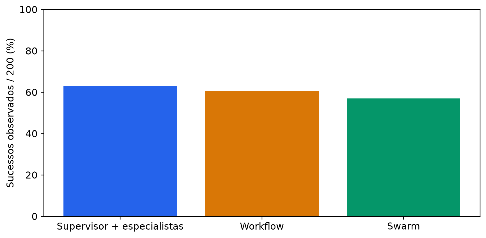
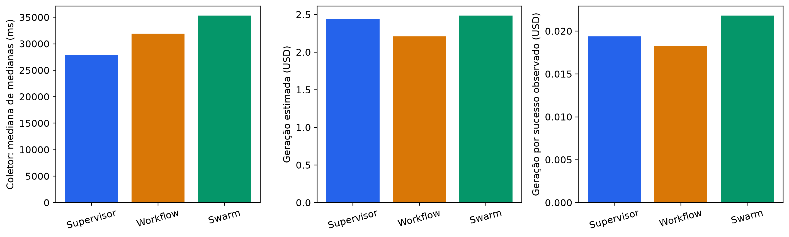
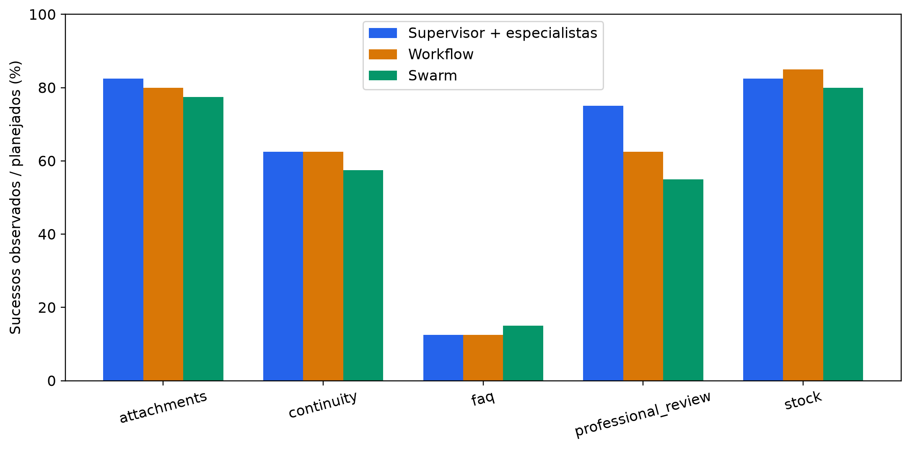
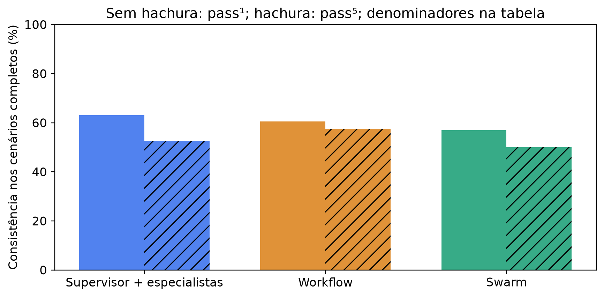
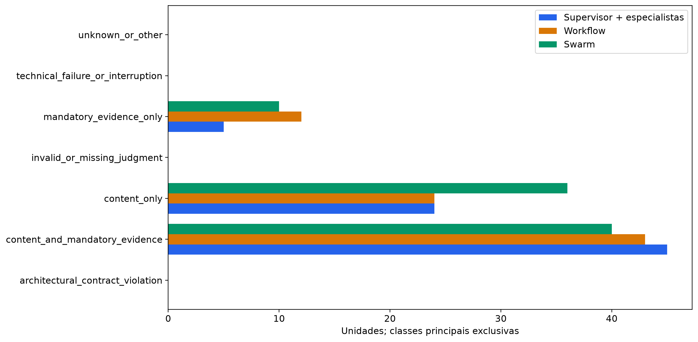

# Comparação arquitetural v4.4

## Escopo e desenho

Nova coleta de 600 tentativas nos mesmos 40 cenários derivados de conversas WhatsApp. Cada cenário recebe cinco repetições por condição. O cenário é a unidade pareada. A condição centralizada usa um supervisor que chama agentes especialistas como ferramentas e mantém a autoria final. Workflow e Swarm preservam as implementações v4.2. A referência de conteúdo, as fontes controladas e o julgador cego são os congelados. A análise e as conclusões de conteúdo são automáticas e provisórias. A avaliação humana da v4.4 permanece pendente.

A geração usou até 48 processos em 13 ondas de tripletas completas, com 12 barreiras verificadas. A latência descreve a carga mista observada.

O lote sequencial anterior terminou com 54 tentativas e 0 julgamentos. As 600 tentativas deste relatório pertencem ao novo lote paralelo, cujo plano foi congelado antes da geração.

O despacho do julgador após a geração usou até 48 processo(s). Os custos e tempos do julgamento ficam separados da geração.

## Resultados e cobertura

| architecture | planned | technical_successes | architectural_compliant | architectural_unknown | task_successes | task_failures | task_unknown | judge_schema_valid | judge_valid_assessment |
| --- | --- | --- | --- | --- | --- | --- | --- | --- | --- |
| centralized_orchestration | 200 | 200 | 200 | 0 | 126 | 74 | 0 | 200 | 200 |
| structured_workflow | 200 | 200 | 200 | 0 | 121 | 79 | 0 | 200 | 200 |
| decentralized_swarm | 200 | 200 | 200 | 0 | 114 | 86 | 0 | 200 | 200 |

A rejeição de uma chamada fora do escopo é medida separadamente do contrato da resposta. A auditoria conferiu que cada ID de chamada rejeitada ficou sem evento de início de ferramenta na mesma tentativa.

| architecture | scope_rejected_tool_requests | attempts_with_scope_rejections | architectural_violations | architectural_candidates_rejected |
| --- | --- | --- | --- | --- |
| centralized_orchestration | 0 | 0 | 0 | 0 |
| structured_workflow | 0 | 0 | 0 | 0 |
| decentralized_swarm | 0 | 0 | 0 | 0 |

O primário exige conclusão técnica, conformidade arquitetural, conteúdo sob o instrumento congelado e evidência de consulta obrigatória. A proporção primária conta sucessos comprovados por 200 unidades planejadas e mantém falhas e desconhecidos separados. As tabelas incluem a taxa entre conhecidos e os limites para os resultados ausentes.

| architecture_a | architecture_b | paired_scenarios | difference_pp_b_minus_a | bootstrap_95_low_pp | bootstrap_95_high_pp | p_holm_three_comparisons |
| --- | --- | --- | --- | --- | --- | --- |
| centralized_orchestration | structured_workflow | 40 | -2.5000 | -9.0000 | 2.0000 | 1.0000 |
| centralized_orchestration | decentralized_swarm | 40 | -6.0000 | -16.0000 | 3.5000 | 0.8760 |
| structured_workflow | decentralized_swarm | 40 | -3.5000 | -11.5000 | 4.5000 | 1.0000 |

O contraste usa o número de sucessos comprovados em cinco tentativas por cenário. Os intervalos percentis marginais vêm de 20.000 reamostragens pareadas de cenários. A permutação bilateral pressupõe invariância conjunta à inversão de sinais e Holm cobre os três contrastes. A inferência é condicional à amostra conhecida. O CSV inclui limites para a atribuição dos desconhecidos.

| architecture | content_successes | content_evaluable | mandatory_evidence_applicable | mandatory_evidence_compliant | mandatory_evidence_evaluable | complete_scenarios | pass_1_complete | pass_5_complete |
| --- | --- | --- | --- | --- | --- | --- | --- | --- |
| centralized_orchestration | 131 | 200 | 95 | 45 | 95 | 40 | 0.6300 | 0.5250 |
| structured_workflow | 133 | 200 | 95 | 40 | 95 | 40 | 0.6050 | 0.5750 |
| decentralized_swarm | 124 | 200 | 95 | 45 | 95 | 40 | 0.5700 | 0.5000 |

## Medições e custos

A latência do núcleo e a do coletor têm fronteiras diferentes. O coletor inclui o subprocesso e os arquivos locais. Os CSVs mostram distribuições por tentativa e quartis das medianas de cenários completos. As estimativas em USD usam uso físico e tarifas padrão. Uso parcial permanece explícito.

| cohort | phase | requests_started | requests_with_usage | known_totalTokens | estimated_cost_usd |
| --- | --- | --- | --- | --- | --- |
| v4.4_main | generation | 2739 | 2739 | 4302451 | 7.1411 |
| v4.4_main | primary | 602 | 602 | 4378731 | 21.8765 |
| v4.4_main | recheck | 15 | 15 | 106734 | 0.5337 |
| engineering_pilot | generation | 74 | 74 | 98738 | 0.1594 |

A sondagem sintética independente registrou 1 rejeição fora do escopo, 0 execuções da solicitação rejeitada e 4 requisições físicas. A sondagem fica separada do lote principal. [Resumo da sondagem](scope-probe-summary.json)

## Rechecagem e limites

Houve 15/15 rechecagens válidas, 15 pares conhecidos e 1 mudanças nesses pares. A rechecagem usa o mesmo julgador e preserva as decisões primárias.

A seleção foi intencional. Anexos são representados por metadados e as referências medem contratos técnicos. As conclusões se restringem aos cenários e configurações observados. Resultados v4.1, v4.2 e v4.3 permanecem como coortes distintas. Os arquivos deste pacote contêm métricas e metadados experimentais sanitizados.

