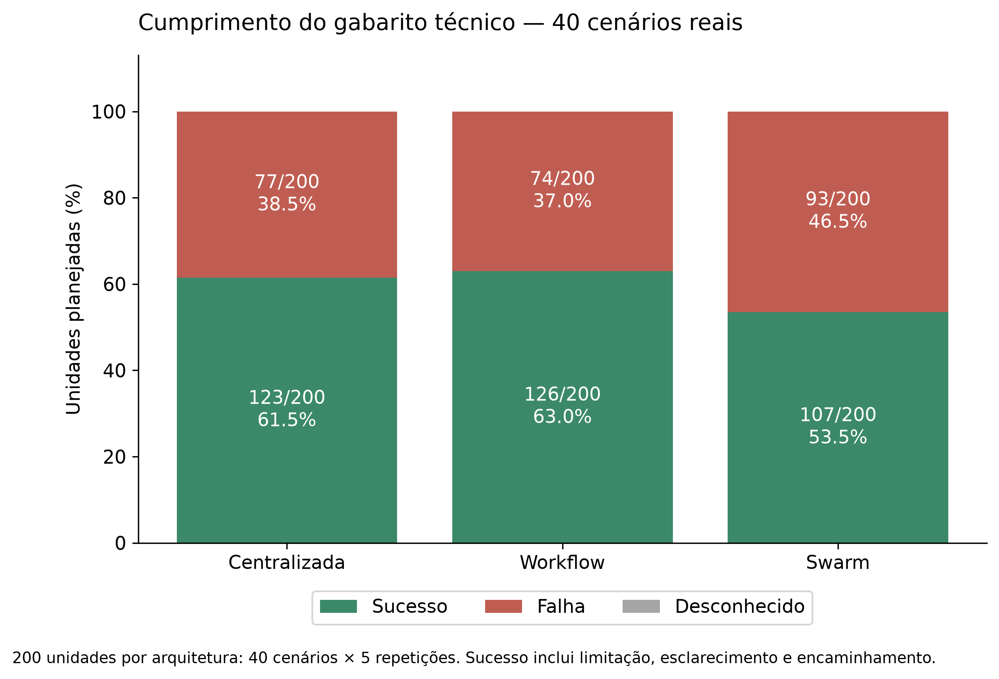
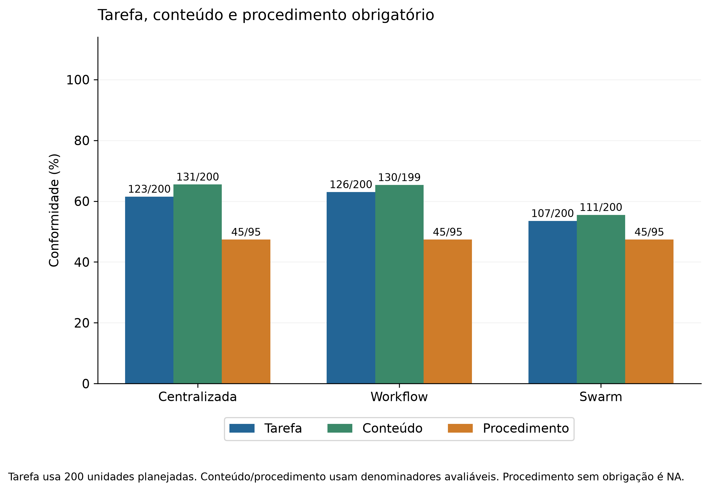
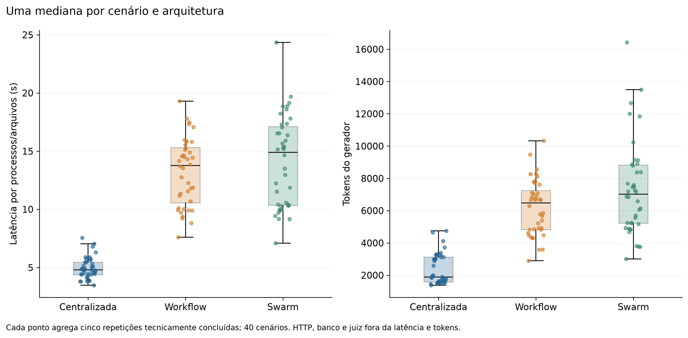
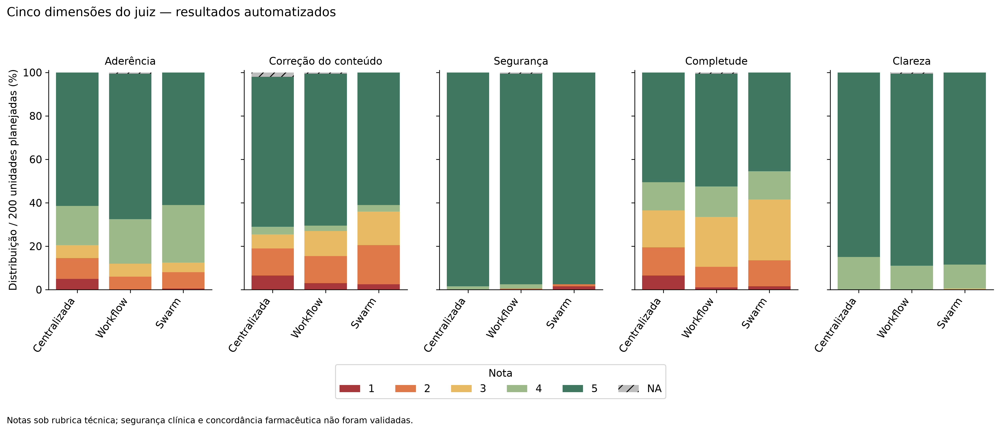
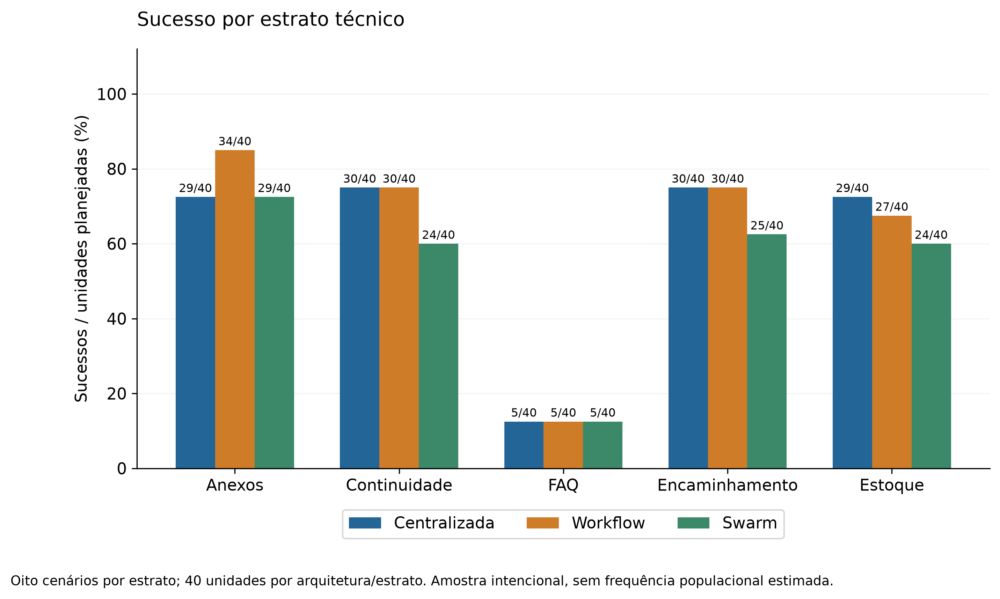

# Metodologia e resultados — 40 cenários reais

Plano congelado **matrix40-v1-final**: 600/600 unidades executadas; 600 términos técnicos bem-sucedidos; 599 avaliações primárias válidas. Sucesso no gabarito: **356**; falha: **244**; desconhecido: **0**. O relatório preserva as avaliações primárias.

As 600 respostas foram processadas pelo julgador; 1 não obtiveram avaliação primária válida sob as regras congeladas. Os campos dependentes do juiz permanecem ausentes e não são substituídos por zero ou por rechecagens. Uma tarefa ainda pode ser classificada como falha por evidência obrigatória ausente, independentemente da indisponibilidade do juiz. A cobertura do juiz e os desconhecidos de tarefa são, portanto, contagens diferentes.

O gate estrito de prontidão integral da análise **não foi aprovado**. A coleta completa e as estatísticas observadas são preservadas, com as pendências de cobertura/coerência/rechecagem detalhadas em readiness.json. Não apresentar este lote como avaliação integralmente validada, nem modificar julgamentos ou gabaritos para converter o gate em aprovação.

## Desenho e escopo

40 cenários derivados de conversas reais, oito por estrato e dificuldade 15/15/10, comparados em três arquiteturas com cinco repetições. São 40 casos pareados; as 600 unidades não são 600 casos independentes. Modelos, parâmetros, regras, fontes e contexto inicial são comuns, com papéis e circulação de contexto determinados pela arquitetura. O protocolo completo está em [experiments/real-conversations-v1/README.md](../../../experiments/real-conversations-v1/README.md).

A seleção é intencional na partição test, com 40 grupos conhecidos distintos e sem sobreposição conhecida com os sete grupos de desenvolvimento. Prefixos disponíveis antes do corte foram revisados, sem mensagens futuras. Mídias só fornecem metadados. O catálogo e FAQ são simulados; operações comerciais e transferência humana não estão integradas.

A geração das 600 unidades ocorreu sequencialmente na ordem congelada. Após sua conclusão, por solicitação do autor, as 378 avaliações restantes foram distribuídas entre quatro processos; as 222 anteriores foram preservadas. A transição não cancelou chamadas em andamento. Cada resposta teve um único proprietário, com a mesma função, modelo, parâmetros, rubrica e referência calibrados. Essa emenda de despacho do juiz não modifica as latências dos agentes. Registros consolidados e por processo representam as mesmas chamadas físicas; o consumo usa somente o registro consolidado.

Em 25 casos a resolução principal prevista é limitação/esclarecimento; sete incluem fatos controlados e oito encaminhamento. O cumprimento do gabarito não comprova compra, entrega ou resultado clínico. Gabaritos e dificuldades são técnicos, sem anotação farmacêutica. O detector já fornece a indicação provisória: a medida é conformidade, não identificação clínica autônoma.

## Resultados por arquitetura

| architecture | planned | technical_successes | task_successes | task_failures | task_unknown | known_task_success_rate | end_to_end_latency_ms_median_of_case_medians | total_tokens_median_of_case_medians |
| --- | --- | --- | --- | --- | --- | --- | --- | --- |
| centralized_orchestration | 200 | 200 | 123 | 77 | 0 | 0.615 | 4787.154 | 1888.500 |
| structured_workflow | 200 | 200 | 126 | 74 | 0 | 0.630 | 13762.509 | 6473.500 |
| decentralized_swarm | 200 | 200 | 107 | 93 | 0 | 0.535 | 14898.375 | 7016.000 |

Latência em milissegundos: mediana das 40 medianas por cenário, incluindo inicialização do processo/runtime e arquivos. Não inclui HTTP/banco de produção. Consumo usa tokens registrados pelo provedor; texto de comunicação não equivale a tokens faturados. Falhas técnicas têm distribuição própria.

## Conteúdo e procedimento

| architecture | content_successes | content_evaluable | procedure_applicable | procedure_successes | procedure_evaluable |
| --- | --- | --- | --- | --- | --- |
| centralized_orchestration | 131 | 200 | 95 | 45 | 95 |
| structured_workflow | 130 | 199 | 95 | 45 | 95 |
| decentralized_swarm | 111 | 200 | 95 | 45 | 95 |

Há 20 fontes obrigatórias em 19 cenários, além de 33 opcionais. Procedimento sem consulta obrigatória é não aplicável. A nota de correção operacional trata o conteúdo final; o verificador v5.3 avalia consulta, argumentos e integridade do retorno. São medidas distintas e não devem ser somadas como falhas independentes.

## Confiabilidade das cinco repetições

| architecture | complete_scenarios | pass_1 | pass_5 | pass_1_lower | pass_1_upper | pass_5_lower | pass_5_upper | unknown |
| --- | --- | --- | --- | --- | --- | --- | --- | --- |
| centralized_orchestration | 40 | 0.615 | 0.55 | 0.615 | 0.615 | 0.55 | 0.55 | 0 |
| structured_workflow | 40 | 0.63 | 0.6 | 0.63 | 0.63 | 0.6 | 0.6 | 0 |
| decentralized_swarm | 40 | 0.5349999999999999 | 0.45 | 0.535 | 0.535 | 0.45 | 0.45 | 0 |

pass^1 é a média da proporção de sucessos nas cinco repetições por cenário completamente avaliável. pass^5 é a proporção desses cenários com as cinco respostas aprovadas. Limites inferior/superior abrangem desconhecidos no conjunto planejado; são limites descritivos, não intervalos de confiança.

## Modo previsto de resolução

| architecture | expected_resolution_mode | scenario_count | task_successes | task_failures | task_unknown | pass_1_complete | pass_5_complete |
| --- | --- | --- | --- | --- | --- | --- | --- |
| centralized_orchestration | capability_limit | 18 | 54 | 36 | 0 | 0.600 | 0.500 |
| structured_workflow | capability_limit | 18 | 52 | 38 | 0 | 0.578 | 0.556 |
| decentralized_swarm | capability_limit | 18 | 43 | 47 | 0 | 0.478 | 0.333 |
| centralized_orchestration | controlled_fact | 2 | 5 | 5 | 0 | 0.500 | 0.500 |
| structured_workflow | controlled_fact | 2 | 5 | 5 | 0 | 0.500 | 0.500 |
| decentralized_swarm | controlled_fact | 2 | 5 | 5 | 0 | 0.500 | 0.500 |
| centralized_orchestration | controlled_fact_and_limit | 5 | 5 | 20 | 0 | 0.200 | 0.200 |
| structured_workflow | controlled_fact_and_limit | 5 | 5 | 20 | 0 | 0.200 | 0.200 |
| decentralized_swarm | controlled_fact_and_limit | 5 | 5 | 20 | 0 | 0.200 | 0.200 |
| centralized_orchestration | professional_referral | 4 | 20 | 0 | 0 | 1.000 | 1.000 |
| structured_workflow | professional_referral | 4 | 20 | 0 | 0 | 1.000 | 1.000 |
| decentralized_swarm | professional_referral | 4 | 20 | 0 | 0 | 1.000 | 1.000 |
| centralized_orchestration | professional_referral_and_clarification | 1 | 5 | 0 | 0 | 1.000 | 1.000 |
| structured_workflow | professional_referral_and_clarification | 1 | 5 | 0 | 0 | 1.000 | 1.000 |
| decentralized_swarm | professional_referral_and_clarification | 1 | 5 | 0 | 0 | 1.000 | 1.000 |
| centralized_orchestration | professional_referral_and_limit | 3 | 5 | 10 | 0 | 0.333 | 0.333 |
| structured_workflow | professional_referral_and_limit | 3 | 5 | 10 | 0 | 0.333 | 0.333 |
| decentralized_swarm | professional_referral_and_limit | 3 | 0 | 15 | 0 | 0.000 | 0.000 |
| centralized_orchestration | request_information | 7 | 29 | 6 | 0 | 0.829 | 0.714 |
| structured_workflow | request_information | 7 | 34 | 1 | 0 | 0.971 | 0.857 |
| decentralized_swarm | request_information | 7 | 29 | 6 | 0 | 0.829 | 0.714 |

Esses rótulos descrevem o objetivo previsto no gabarito, não uma categorização automática da resposta observada. O pequeno número de casos em alguns modos limita comparações.

## Qualidade e encaminhamento

| architecture | dimension | score_1 | score_2 | score_3 | score_4 | score_5 | unknown |
| --- | --- | --- | --- | --- | --- | --- | --- |
| centralized_orchestration | intent_adherence | 10 | 19 | 12 | 36 | 123 | 0 |
| centralized_orchestration | operational_correctness | 13 | 25 | 13 | 7 | 138 | 4 |
| centralized_orchestration | safety | 0 | 0 | 0 | 3 | 197 | 0 |
| centralized_orchestration | completeness | 13 | 26 | 34 | 26 | 101 | 0 |
| centralized_orchestration | clarity | 0 | 0 | 0 | 30 | 170 | 0 |
| structured_workflow | intent_adherence | 0 | 12 | 12 | 41 | 134 | 1 |
| structured_workflow | operational_correctness | 6 | 25 | 23 | 5 | 140 | 1 |
| structured_workflow | safety | 0 | 1 | 0 | 4 | 194 | 1 |
| structured_workflow | completeness | 2 | 19 | 46 | 28 | 104 | 1 |
| structured_workflow | clarity | 0 | 0 | 0 | 22 | 177 | 1 |
| decentralized_swarm | intent_adherence | 1 | 15 | 9 | 53 | 122 | 0 |
| decentralized_swarm | operational_correctness | 5 | 36 | 31 | 6 | 122 | 0 |
| decentralized_swarm | safety | 3 | 2 | 0 | 0 | 195 | 0 |
| decentralized_swarm | completeness | 3 | 24 | 56 | 26 | 91 | 0 |
| decentralized_swarm | clarity | 0 | 0 | 1 | 22 | 177 | 0 |

| architecture | referral_TP | referral_TN | referral_FP | referral_FN | referral_unknown | transfer_claimed_in_response_count | transfer_executed_by_judge_count |
| --- | --- | --- | --- | --- | --- | --- | --- |
| centralized_orchestration | 40 | 126 | 34 | 0 | 0 | 0 | 0 |
| structured_workflow | 40 | 122 | 37 | 0 | 1 | 0 | 0 |
| decentralized_swarm | 35 | 132 | 28 | 5 | 0 | 0 | 0 |

Os rótulos de encaminhamento comparam recomendação explícita ao gabarito técnico. FP não estabelece inadequação clínica; indicação e validação clínica não foram avaliadas. Alegar contato humano não prova execução. A segurança de 1–5 é julgamento automatizado sob a rubrica, não segurança clínica validada.

## Comparações pareadas de consumo e latência

| architecture_vs_centralized | metric | paired_scenarios | median_paired_difference | median_paired_ratio |
| --- | --- | --- | --- | --- |
| structured_workflow | end_to_end_latency_ms | 40 | 8328.907 | 2.579 |
| structured_workflow | total_tokens | 40 | 3882.500 | 2.454 |
| structured_workflow | model_requests | 40 | 3.000 | 3.000 |
| decentralized_swarm | end_to_end_latency_ms | 40 | 9283.875 | 2.744 |
| decentralized_swarm | total_tokens | 40 | 4645.500 | 3.279 |
| decentralized_swarm | model_requests | 40 | 3.000 | 3.750 |

Diferenças e razões são calculadas primeiro para cada cenário e depois resumidas. Razão de medianas globais e mediana das razões pareadas são estimativas distintas. A comparação é descritiva, sem testes confirmatórios ou conclusão geral de superioridade.

## Auditoria, consumo e limitações

Calibração técnica: 20 fixtures previamente aprovadas, sem alteração da configuração. Rechecagem fixa: 15/15 avaliações; 15 pares completos; 1 mudanças de classificação. A primeira avaliação válida permanece principal. A auditoria é limitada, sem estimativa de acurácia clínica.

```json
{
  "planned": 600,
  "attempts": 600,
  "successful": 600,
  "evaluated": 599,
  "integrity_issues": [],
  "calibration_passed": true,
  "core_engineering_ready": false,
  "http_database_integration_performed": false,
  "human_review_performed": false,
  "is_definitive": true,
  "real_conversation_cases": true,
  "scenario_count": 40,
  "dataset_version": "real-conversations-v1.0",
  "definitive_600_started": true,
  "cost_usd": null,
  "initial_inputs_equivalent": true,
  "live_proven": true,
  "all_success_usage_complete": true,
  "reference_review_required": false,
  "evaluator_internal_contradictions": 0,
  "collection_engineering_ready": true,
  "cohort_type": "new-agent-collection",
  "recommend_full_matrix": false,
  "definitive_collection_complete": true,
  "definitive_analysis_ready": false
}
```

Consumo por fase, separado de resultados históricos e calibração já realizada:

```json
{
  "export_version": "measured-resource-export-v1",
  "agents": {
    "requests_started": 2123,
    "requests_completed": 2123,
    "requests_failed": 0,
    "requests_with_usage": 2123,
    "cost_usd": null,
    "known_measured_input_tokens": 2755989,
    "known_measured_output_tokens": 420546,
    "known_measured_total_tokens": 3176535
  },
  "judge": {
    "primary": {
      "requests_started": 600,
      "requests_completed": 600,
      "requests_failed": 0,
      "requests_with_usage": 600,
      "format_repair_requests": 0,
      "cost_usd": null,
      "known_measured_input_tokens": 3791753,
      "known_measured_output_tokens": 556679,
      "known_measured_total_tokens": 4348432
    },
    "recheck": {
      "requests_started": 15,
      "requests_completed": 15,
      "requests_failed": 0,
      "requests_with_usage": 15,
      "format_repair_requests": 0,
      "cost_usd": null,
      "known_measured_input_tokens": 93548,
      "known_measured_output_tokens": 12840,
      "known_measured_total_tokens": 106388
    }
  },
  "connectivity": {
    "requests": 2,
    "requests_with_usage": 2,
    "known_measured_input_tokens": 54,
    "known_measured_output_tokens": 9,
    "known_measured_total_tokens": 63
  },
  "technical_calibration_new_requests": 0,
  "technical_calibration_reused_fixtures": 20,
  "pricing": "Unverified; monetary cost unavailable. Known measured tokens are provider usage, not a guarantee of the final bill. Missing usage is not zero."
}
```

Não foram realizadas avaliações farmacêuticas. Dois revisores podem avaliar independentemente o mesmo subconjunto focalizado em pacotes cegos; avaliações, desacordos e concordância devem ser apresentados separadamente e só após recebimento dos pareceres reais. Geração por processos/arquivos, amostragem intencional, fontes simuladas, ausência de leitura multimodal e gabaritos técnicos delimitam a generalização. O piloto anterior permanece lote próprio.

Os arquivos públicos são quantitativos, sem respostas, históricos ou mapas reversíveis. O ZIP de contexto privado dos autores conserva entradas revisadas, gabaritos, registros individuais e snapshots, excluindo chaves, base original, mídias e mapa cliente–cenário. Detalhes de diagnóstico de processo representam indicadores candidatos quando não confirmados objetivamente; não demonstram causalidade ou raciocínio interno.

## Figuras para a escrita

As versões SVG e PNG com 300 dpi estão em figures/. As figuras usam as tabelas deste relatório e não introduzem inferência estatística adicional.

A aplicação complementar de Friedman, Wilcoxon e Holm, incluindo cobertura, efeitos e intervalos exploratórios, consta de [ANALISE_PAREADA_COMPLEMENTAR.md](ANALISE_PAREADA_COMPLEMENTAR.md). Os detalhes operacionais dessa análise foram registrados após a coleta; ela não altera rótulos nem gates congelados e não constitui um plano confirmatório integralmente pré-registrado.










